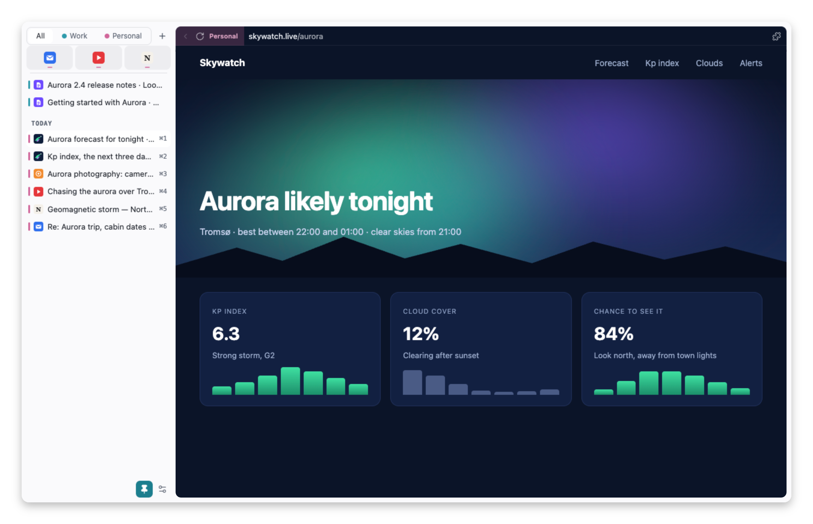
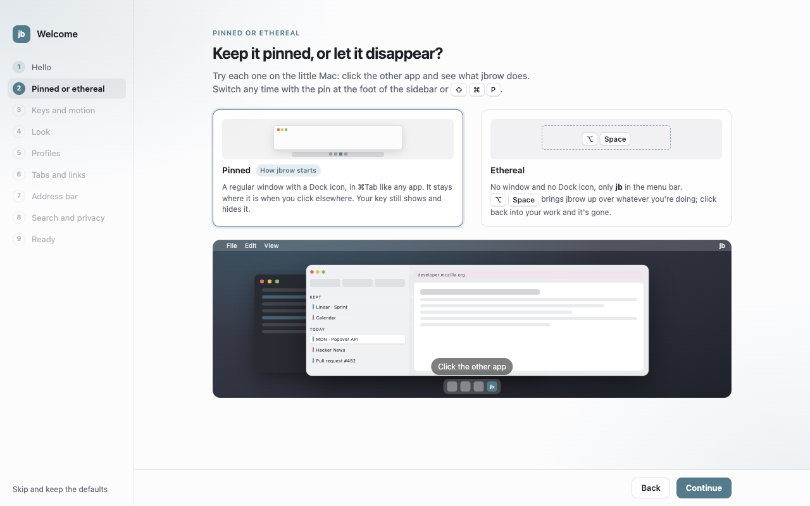
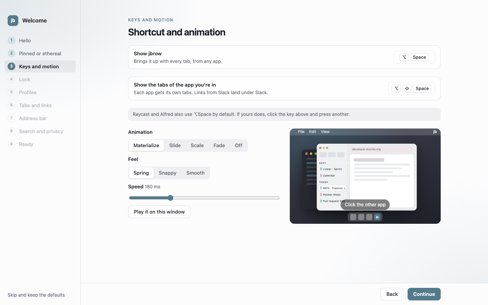
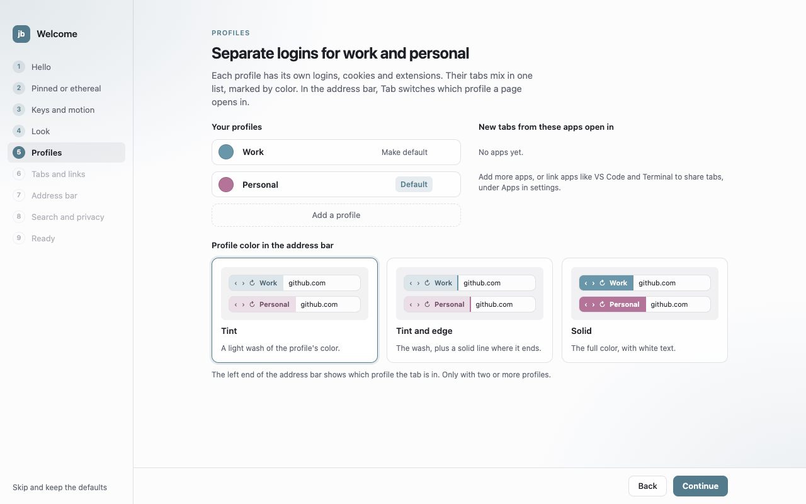
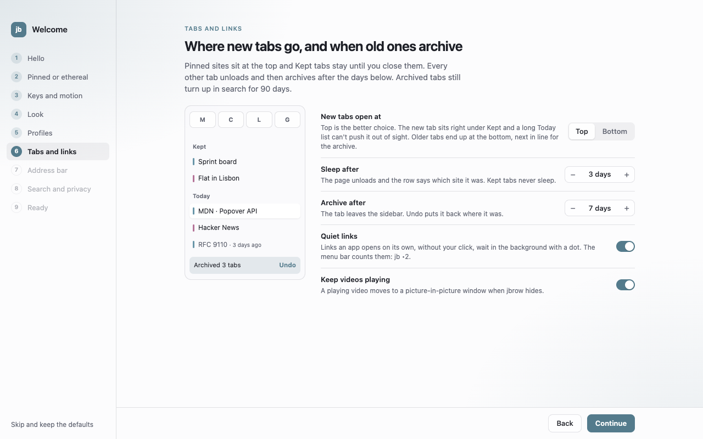

# jbrow

A browser that isn't there until you call it. Press ⌥Space and it comes up over whatever you're
doing. Click into another app and it's gone. Or keep it pinned as a normal window, which is how it
starts.

It's Chromium underneath (through Electron), with profiles, Chrome Web Store extensions and a
sidebar of tabs.

<picture>
  <source media="(prefers-color-scheme: dark)" srcset="docs/img/jbrow-dark.png">
  
</picture>

## Install

Get it from [the latest release](https://github.com/join3r/jbrow/releases/latest).

- **Mac** (Apple Silicon, macOS 13+): open the DMG and drag `jbrow.app` into Applications.
- **Windows** (10 or 11, x64): run `jbrow-<version>-x64-setup.exe`. It isn't code-signed yet, so
  SmartScreen warns once. Click **More info**, then **Run anyway**.
- **Linux** (x64): `sudo apt install ./jbrow_<version>_amd64.deb` on Debian and Ubuntu, or the
  AppImage elsewhere (needs `libfuse2`; on Ubuntu 24.04+ use the `.deb`).

jbrow updates itself from GitHub Releases. A few things are Mac only for now: ⌥⇧Space, per-app
profiles and trackpad swipes.

## First run

A short welcome sets up the parts that matter. Every choice applies right away, and
**Help → Welcome to jbrow** brings it back later.

| | |
|---|---|
| <picture><source media="(prefers-color-scheme: dark)" srcset="docs/img/welcome-mode-dark.png"></picture> | <picture><source media="(prefers-color-scheme: dark)" srcset="docs/img/welcome-keys-dark.png"></picture> |
| **Pinned or ethereal.** A regular window, or one that only shows on its key. | **Keys and motion.** Pick the summon keys and how the window animates. |
| <picture><source media="(prefers-color-scheme: dark)" srcset="docs/img/welcome-profiles-dark.png"></picture> | <picture><source media="(prefers-color-scheme: dark)" srcset="docs/img/welcome-tabs-dark.png"></picture> |
| **Profiles.** Separate logins for work and personal, in one tab list. | **Tabs and links.** Old tabs sleep, then archive. Undo puts them back. |

## What's in it

- **One hotkey.** ⌥Space shows and hides jbrow with all its tabs. ⌥⇧Space shows only the tabs of
  the app you were in.
- **Tabs like Arc.** Pinned icons, Kept tabs that stay, and Today. Tabs unseen for a week archive
  themselves, and you can search and restore them.
- **Profiles in one list.** Each tab has a profile color. Tab in the address bar switches which
  profile a page opens in, and links from Slack can land in Work.
- **Split view.** ⌘D puts up to 4 tabs side by side.
- **Extensions** from the Chrome Web Store, per profile, including side panels.
- **Quiet links.** Links a script opens without your click go to the background, muted.
- **Restyle any site** with Claude Code or Codex: click the wand, type "dark theme", watch it change.
- **Phishing and malware warnings**, checked on your Mac against lists it downloads.

## Keys

| Key | Does |
|---|---|
| ⌥Space | Show or hide jbrow |
| ⌥⇧Space | Show only the tabs of the app you were in |
| ⌘T / ⇧⌘N | New tab / new tab in the next profile |
| ⌘D | Split view |
| ⇧⌘T | Reopen the last closed tab |
| ⇧⌘P | Pin or unpin the window |
| ⌘, | Settings |

All of them can be changed under **Shortcuts** in settings. On Windows and Linux, ⌘ is Ctrl.

## More

- [The guide](docs/guide.md) covers every feature, setting and file.
- [How extensions fare](docs/extension-checklist.md) in jbrow.
- [CONTRIBUTING.md](CONTRIBUTING.md) explains building and testing from source.

## Privacy

No telemetry, no crash reports, no account. Without you opening a page, jbrow only talks to your
search engine (for suggestions as you type), malware-filter.gitlab.io (the phishing lists), GitHub
Releases (updates) and the Chrome Web Store (extension updates). Search suggestions and the
phishing lists can be turned off, and updates can wait until you ask. The [guide](docs/guide.md#privacy) has the details.

jbrow tells sites it's Chrome so the Web Store works. It isn't a Google product and isn't
affiliated with Google.

## Reporting a bug

Open an issue on [GitHub](https://github.com/join3r/jbrow/issues), or use **Help → Report a Bug…**.
Say which OS and jbrow version you have, and attach `~/Library/Logs/jbrow/main.log` (look through
it first, it can hold addresses you visited).

## License

[GPL-3.0-only](https://www.gnu.org/licenses/gpl-3.0.html), as electron-chrome-extensions requires.
Third-party software and data are listed in [THIRD_PARTY_NOTICES.md](THIRD_PARTY_NOTICES.md).
